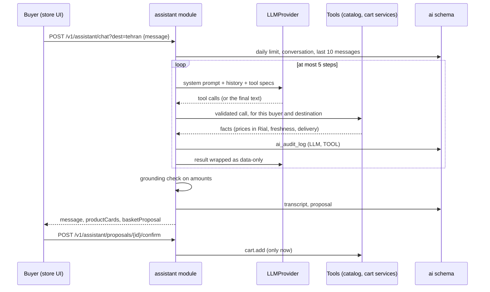

# AI architecture — shopping assistant (Baghboon)

> Status: first version. The brief (Prompt 12) describes a separate `ai-gateway` service; under
> [ADR 0008](adr/0008-modular-monolith-first.md) it is the `assistant` module of `apps/api` and owns the `ai` schema.
> The embedding pipeline (Prompt 13) will be the Python worker under `services/` and is not built yet.

## One turn

## The rules and where they are enforced

| Rule (CLAUDE.md, architecture §7) | Enforced by |
|---|---|
| Model access only through one interface | `LlmProvider` in `modules/assistant/llm.ts`; chosen by `LLM_PROVIDER` |
| The model never touches the database | Tools call `CatalogService` / `CartService`; no SQL, no tool that writes |
| Prices, stock, freshness come from tools | Tools return them; `ungroundedNumbers` rejects an answer whose amounts are not in this turn's tool results (or the buyer's own words) and replaces it with a neutral text. Product cards and basket totals are built by the server, never parsed from model text |
| Product text is untrusted | `sanitizeUntrusted` (no angle brackets, 300 characters) and `<tool_result trust="data-only">` wrapping; the system prompt says data is never an instruction |
| Orders and payment need the buyer's confirmation | There is no order, payment or cart-write tool. `build_basket` / `propose_basket` store a row in `ai.proposals`; `POST …/confirm` adds it to the cart once |
| Every tool call is logged | `ai.ai_audit_log` rows of kind `LLM`, `TOOL`, `GUARD`; phone numbers and long digit runs are redacted first |
| Graceful degradation | A model failure is `503 ASSISTANT_UNAVAILABLE`; `/v1/search` does not depend on the model |
| Cost control | `AI_DAILY_MESSAGES` per buyer, 500 characters per message, 5 steps and 4 tool calls per step, 1024 output tokens per call |

## Providers

| `LLM_PROVIDER` | What it is |
|---|---|
| `fake` (default) | Rule-based stand-in (`fake-llm.ts`): fixed rules choose one tool and the answer is written only from its result. Runs the evals in CI and keeps the assistant usable with no model |
| `openai-compatible` | Any server with the chat-completions protocol: a self-hosted open model (vLLM, Ollama, llama.cpp) or a hosted service. `LLM_BASE_URL`, `LLM_MODEL`, optional `LLM_API_KEY` |

A hosted-provider adapter with its own protocol is one more class implementing `LlmProvider`. Which hosted
provider to use is an open decision (servers in Iran limit the choice, brief §3 note).

## Tools

| Tool | Returns |
|---|---|
| `search_products` | Up to 6 listings that reach the destination fresh, with landed price per kilo, harvest age, arrival time, packages |
| `get_product` | One listing: seller description (untrusted), delivery options, market median, shop statistics |
| `compare_products` | The comparison formula's ranking for one produce type |
| `get_seasonal_suggestions` | Produce in season this Jalali month that has sellers |
| `get_cart` | The buyer's cart (read only) |
| `build_basket` | A seasonal basket for a budget and head count, stored as a proposal |
| `propose_basket` | The model's own choice of items, priced by the server and stored as a proposal |

## Evals

`services/ai/evals/*.yaml` hold Persian cases (shopping and safety); `apps/api/test/assistant-evals.test.ts` runs
them in CI with the rule-based model and adds checks that hold for any model: amounts are grounded, the cart is
untouched by chat, every tool call is audited. `apps/api/test/assistant.test.ts` drives the loop with a scripted
model behind the real adapter (ungrounded price, unknown tool, runaway tool calls, hostile seller text, outage).

## Not built yet

Word-by-word streaming (today `POST /v1/assistant/chat/stream` streams the steps and then the checked answer), semantic cache, summarised long-term memory and transcript retention, reorder from past orders,
a run of the evals against a real model,
smart search and embeddings (Prompt 13), smart compare explanations (Prompt 15).
