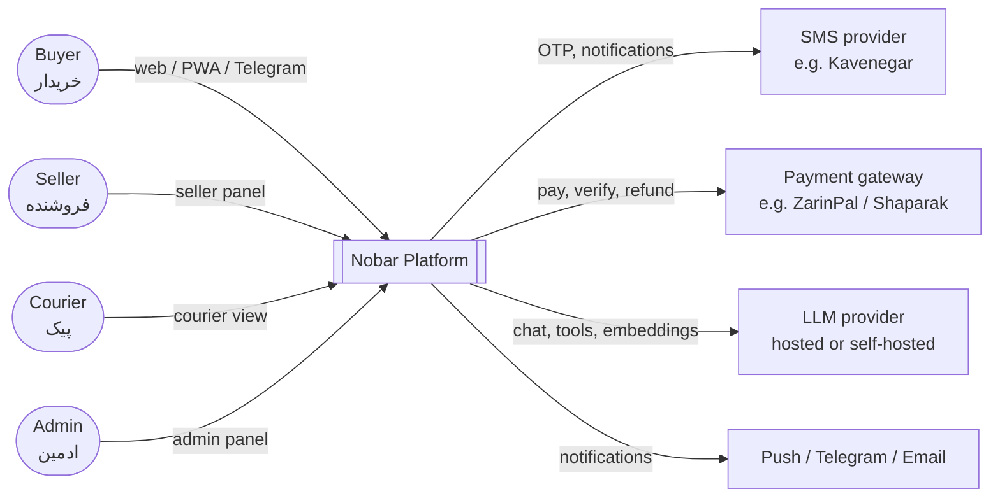
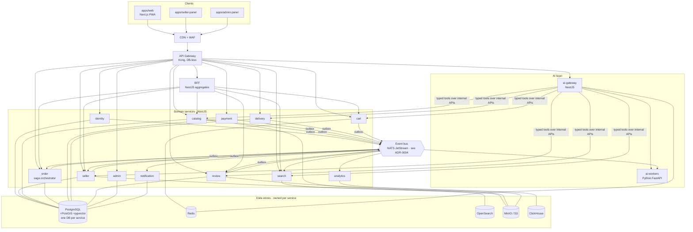
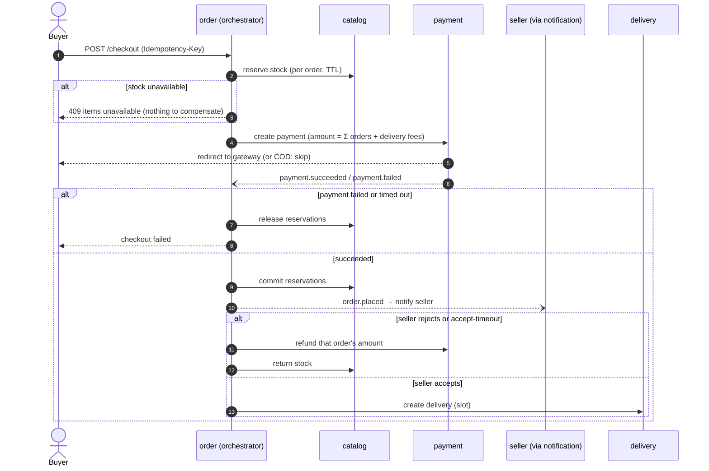
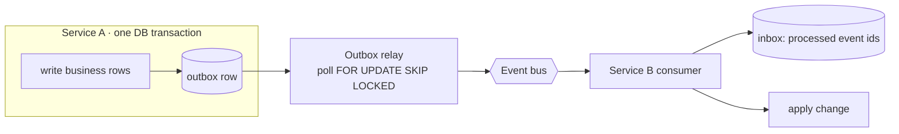

# Nobar — Architecture

> Status: **Draft for approval** · Last updated: 2026-10-22
> **2026-10-31:** the backend is now a modular monolith ([ADR 0008](adr/0008-modular-monolith-first.md)) and the marketplace is nationwide. The service split below becomes the module split inside `apps/api`; each "database per service" becomes a schema per module.
> Source brief: [brief/nobar-architecture-brief.fa.md](brief/nobar-architecture-brief.fa.md) · Decisions: [adr/](adr/README.md) · Domain: [domain.md](domain.md)

## 1. Goals and quality attributes

Nobar connects local sellers (farmers, orchard owners, stall owners) with buyers **across Iran** (nationwide since 2026-10-31; delivery is limited by freshness on arrival).
The goods are perishable, so the architecture is optimized for:

| Quality attribute | What it means for Nobar | Primary mechanisms |
|---|---|---|
| Freshness & speed | Harvest date, stock and delivery slot must be accurate in near real time | Event-driven sync, stock reservation, city-scoped queries |
| Trust | Prices/stock/reviews are never invented, payments are exact and auditable | Integer Rial, double-entry ledger, audit logs, AI only reads facts via tools |
| Availability | Checkout 99.5%; browsing/search keep working when AI or a gateway is down | Graceful degradation, circuit breakers, Saga compensation |
| Performance | Search p95 < 300 ms | OpenSearch read model, city routing, caching |
| Scalability | Daily peaks (morning/evening) and event peaks (Yalda, Nowruz) | Stateless services, HPA/KEDA, CDN |
| Evolvability | Services, LLM provider, event bus are replaceable | Clean boundaries, contracts, provider interfaces, ADRs |
| Persian-first | RTL, Jalali, Toman display, Iranian SMS/payment providers | Shared i18n/format packages, provider adapters |

## 2. System context



## 3. Container view



Rules shown by the diagram:

- **Single public entrypoint**: only the gateway is exposed. Services are reachable only inside the cluster (enforced with NetworkPolicy in Kubernetes).
- **BFF** exists only for *aggregate reads* (home page, product page with seller and reviews, checkout summary). It owns no data and no business rules.
- **AI never touches a database.** `ai-gateway` calls the same internal APIs a client would, with the user's identity (see §7).

## 4. Services, responsibilities and data ownership

Every service owns its data exclusively (ADR-0005). Other services get that data through the owner's API or by keeping their own **read model** built from the owner's events.

| Service | Responsibility | Owns (writes) | Store | Publishes | Consumes |
|---|---|---|---|---|---|
| **identity** | OTP login, JWT + refresh tokens, roles/RBAC, profile, addresses | users, otp_challenges, refresh_tokens, addresses | PostgreSQL, Redis (rate limit) | `user.registered`, `user.updated` | — |
| **seller** | Seller onboarding & verification, documents, shop profile, delivery coverage, reliability stats (read model) | sellers, seller_documents, seller_stats | PostgreSQL, MinIO | `seller.registered`, `seller.approved`, `seller.rejected`, `seller.suspended` | `order.*`, `delivery.completed`, `review.created` (for stats) |
| **catalog** | Categories, products, units, price, stock & reservations, harvest date / freshness, images | categories, products, product_images, stock_reservations | PostgreSQL, MinIO | `product.created`, `product.updated`, `product.archived`, `stock.changed`, `stock.low` | `seller.approved/suspended` (local seller status cache) |
| **search** | Persian full-text search, filters, facets, autocomplete; later hybrid (BM25 + vector) | search index (read model only) | OpenSearch | — | `product.*`, `stock.changed`, `seller.*`, `review.aggregated` |
| **cart** | One cart per user, grouped by seller, guest cart merge, re-validation on read | carts | Redis | `cart.updated` (analytics only) | `product.updated`, `stock.changed` (optional invalidation) |
| **order** | Checkout, split per seller, order state machine, **checkout saga orchestrator** | checkouts, orders, order_items, saga_state | PostgreSQL | `order.placed`, `order.accepted`, `order.rejected`, `order.cancelled`, `order.delivered` | `payment.*`, `delivery.*` |
| **payment** | Gateway/COD/wallet payments, callbacks, refunds, commission, ledger, settlements | payments, refunds, ledger_entries, wallets, commission_rules, settlements | PostgreSQL | `payment.succeeded`, `payment.failed`, `payment.refunded`, `settlement.paid` | `order.delivered`, `order.cancelled` |
| **delivery** | Delivery zones (PostGIS), time slots, fee calculation, courier assignment, tracking, proof of delivery | zones, slots, deliveries, couriers | PostgreSQL + PostGIS | `delivery.assigned`, `delivery.picked_up`, `delivery.completed`, `delivery.failed` | `order.accepted`, `order.cancelled` |
| **review** | Reviews & ratings (only from delivered orders), quality reports, seller replies, moderation | reviews, quality_reports, review_aggregates | PostgreSQL, MinIO | `review.created`, `review.aggregated` | `order.delivered` (eligibility) |
| **notification** | SMS / push / Telegram / email, Persian templates, preferences, retries | templates, notification_log, preferences | PostgreSQL, Redis | — | almost every domain event |
| **analytics** | Behavioural and business events, reports | event tables | ClickHouse | — | all events + client tracking events |
| **admin** | Back-office workflows that have no other owner: operating cities, disputes, platform settings; orchestrates admin actions by calling owning services | cities (operational), disputes, platform_settings | PostgreSQL | `city.activated`, `city.deactivated`, `dispute.*` | `review.*` (moderation), `seller.registered` (approval queue) |
| **ai-gateway** | Single entry for AI: auth, budgets, guardrails, agent routing, semantic cache, tool layer, audit | ai_conversations, ai_audit_log, budgets | PostgreSQL, Redis | `ai.feedback.recorded` | — |
| **ai-workers** (Python) | Embeddings, review insights, recommendations, forecasting, moderation models | product_embeddings, review_insights, recsys features | PostgreSQL + pgvector, ClickHouse (read) | `review.insights.updated` | `product.*`, `review.*`, analytics data |

> Admin actions on data owned by others (approve a seller, change a commission rule, hide a review) are **calls to the owning service's admin API**. The admin service never writes another service's data.

## 5. Communication: sync vs async

| Use | Style | Why |
|---|---|---|
| Client → platform | HTTPS REST (JSON) via gateway; SSE for assistant streaming | Simple, cacheable, browser-native |
| Query that needs an answer *now* (e.g. cart re-validates price, AI tool `get_product`) | Sync REST between services, typed clients generated from OpenAPI | Read-your-writes, simple |
| Saga commands (reserve stock, create payment, create delivery) | Sync REST **with an idempotency key**, results also confirmed via events | Orchestrator needs a clear yes/no; idempotency makes retries safe |
| "Something happened" (state changes) | Async events through the bus, published via **Outbox** | Decoupling, fan-out, replay (search reindex, embeddings) |

Guard rails for sync calls: timeouts on every call (default 2 s), retries only for idempotent requests (exponential backoff + jitter), circuit breaker per downstream, and **no sync call chains deeper than 2 hops**. gRPC is an option later for hot internal paths; REST first keeps contracts readable for the seminar.

### 5.1 Event conventions

- **Naming**: `<aggregate>.<past-tense-verb>` (`order.placed`, `stock.changed`). Bus subject/topic: `nobar.<aggregate>.<event>.v<major>` (e.g. `nobar.order.placed.v1`).
- **Envelope** (CloudEvents 1.0 compatible), defined once in `packages/contracts`:

```jsonc
{
  "specversion": "1.0",
  "id": "0192b7e0-…",               // UUIDv7, unique per event → dedup key
  "type": "order.placed",
  "dataschema": "nobar/order.placed/v1",
  "source": "order-service",
  "subject": "order/0192b7d1-…",     // aggregate id → ordering/partition key
  "time": "2026-10-22T07:30:00Z",   // UTC
  "nobarcityid": "tehran",           // city-first routing & filtering
  "traceparent": "00-…",             // W3C trace context
  "data": { }
}
```

- **Versioning**: additive changes keep the version; breaking changes publish a new `vN` in parallel until all consumers migrate. Schemas live in `packages/contracts` and are contract-tested.
- **Delivery semantics**: at-least-once. Every consumer is idempotent (inbox table of processed event ids) and failures go to a dead-letter subject after N retries.
- **Ordering**: guaranteed per aggregate (key = `subject`), never globally.

## 6. Key patterns

### 6.1 Saga (orchestration) — checkout

The **order** service orchestrates. A buyer checkout with items from several sellers creates one `checkout` (paid once) containing one `order` per seller (see domain.md §3 and open question Q1).



Every step has a compensating action; saga state is persisted so the orchestrator resumes after a crash. The full diagram with every failure path is produced in Phase 1 (`docs/sagas/checkout.md`).

### 6.2 Transactional Outbox + Inbox



The business change and the event are committed atomically, so we never publish an event for a rolled-back change or lose one for a committed change. The relay is a small in-process worker in each service (shared from `packages/common`). CDC with Debezium is a later option.

### 6.3 CQRS-lite

Writes go to the owning PostgreSQL database; heavy reads use purpose-built read models: **search** (OpenSearch, from `product.*`), **seller_stats**, **review_aggregates**, and the BFF's aggregate views. Read models are rebuildable by replaying events or running a reindex job.

### 6.4 Idempotency

`Idempotency-Key` header is required on `POST /checkout`, payment creation, refunds, and all saga commands. The server stores `(key, caller, request_hash, response)` for 24 h: same key + same body → same response; same key + different body → `422`. Payment gateway callbacks are idempotent by gateway reference id and always verified server-to-server.

### 6.5 Resilience

Circuit breakers + retries around payment gateways, SMS and LLM providers. **Graceful degradation**: if AI is down, `/search` (non-AI) and filters still work; if SMS is down, OTP falls back to a secondary provider; if search is down, the BFF serves category listings from catalog.

## 7. AI layer (summary)

Full design in Phase 3 (`docs/ai-architecture.md`). Non-negotiables already fixed here:

1. All model calls go through the `LLMProvider` interface (hosted, self-hosted OpenAI-compatible, fake for tests), selected by config.
2. Facts (price, stock, freshness, ratings) come **only** from tools that call internal APIs with the **end user's** JWT; the model has no DB access.
3. Product text and reviews are untrusted input (prompt-injection defense).
4. Checkout and payment are **not tools**; the assistant proposes a basket, the user confirms in the UI.
5. Every tool call is written to `ai_audit_log`; behaviour is regression-tested by Persian evals in CI.

## 8. City-first design

- Every buyer request carries a city (from profile or the city selector); search **requires** `city_id`.
- Seller, product, delivery zone, and order all carry `city_id`; DB indexes lead with `city_id` where queries filter by it.
- OpenSearch uses custom routing by `city_id` so a query touches only the shards for that city.
- Event envelopes carry `nobarcityid` so consumers can filter, and so we can later shard workloads by city or region.

## 9. Cross-cutting concerns

| Concern | Decision |
|---|---|
| Authentication | Identity issues short-lived JWT access tokens (15 min, asymmetric keys, JWKS endpoint) + rotating refresh tokens stored hashed. Gateway verifies; services re-verify claims (defense in depth). |
| Authorization | Roles BUYER / SELLER / COURIER / ADMIN + ownership checks inside services (a seller edits only own products). |
| Configuration | Env vars only, validated at startup (fail fast). Secrets via External Secrets / Sealed Secrets in Kubernetes; never committed. |
| Observability | Every service exposes `/healthz`, `/readyz`, `/metrics`; pino JSON logs with `trace_id`; OpenTelemetry traces through gateway → services → bus. |
| Money | Integer **Rial** (`bigint`) everywhere; Toman only as a display format. |
| Time | Stored in UTC; displayed in Asia/Tehran with the Jalali calendar. |
| Text | Persian normalization (ی/ي, ک/ك, ZWNJ, Persian/Arabic digits) in one shared package, used by search and AI. |
| API style | REST + OpenAPI 3.1 per service; errors as RFC 9457 Problem Details; cursor pagination. |

## 10. Local development profile (8 GB RAM)

The full stack does not fit on the primary dev machine, so local infrastructure is split into docker compose **profiles**, and developers run only the services they are working on.

| Profile | Containers | Approx. RAM |
|---|---|---|
| `core` (default) | PostgreSQL (all service DBs), Redis, NATS JetStream | ~350 MB |
| `search` | OpenSearch (heap capped at 512 MB) | ~1 GB |
| `storage` | MinIO, Mailpit | ~250 MB |
| `obs` | Jaeger all-in-one, Prometheus, Grafana (+ Loki) | ~700 MB |
| `ai` | (Phase 3) pgvector is already in `core`; optional local model server | varies |

Kubernetes demos run on **k3d** (lightweight k3s) with a subset of services; full-scale deployment targets a real cluster (see Phase 2).

## 11. Repository layout

```
/apps        web, seller-panel, admin-panel                (Next.js)
/services    identity, seller, catalog, search, cart, order, payment, delivery,
             review, notification, analytics, admin, ai-gateway, bff   (NestJS)
             ai-workers                                                (Python)
/packages    common, contracts, ui, config (eslint/tsconfig), fa (Persian utils)
/infra       docker-compose, helm, argocd, terraform, k8s-local
/docs        architecture, domain, adr, roadmap, sagas, runbooks
```
