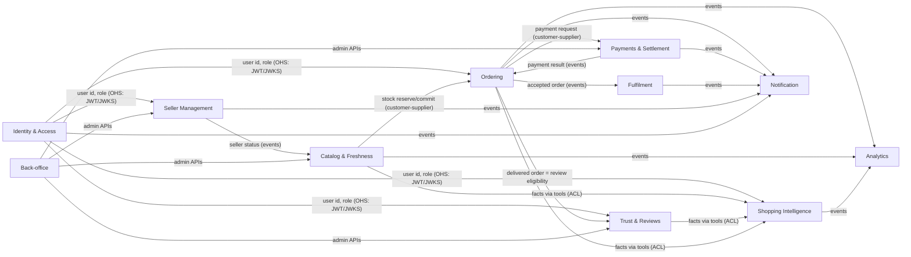
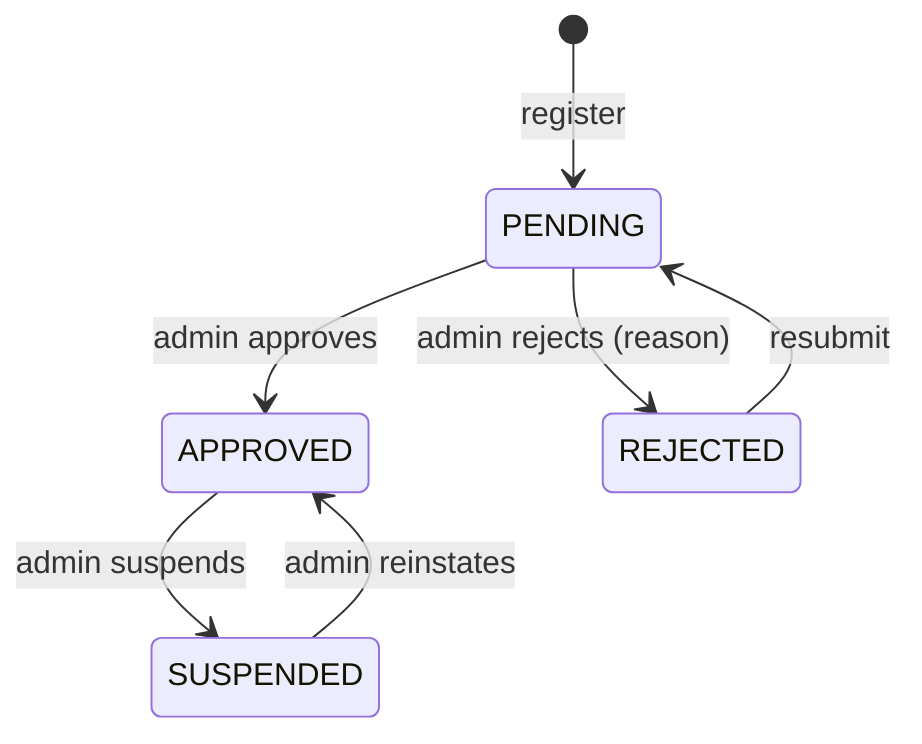
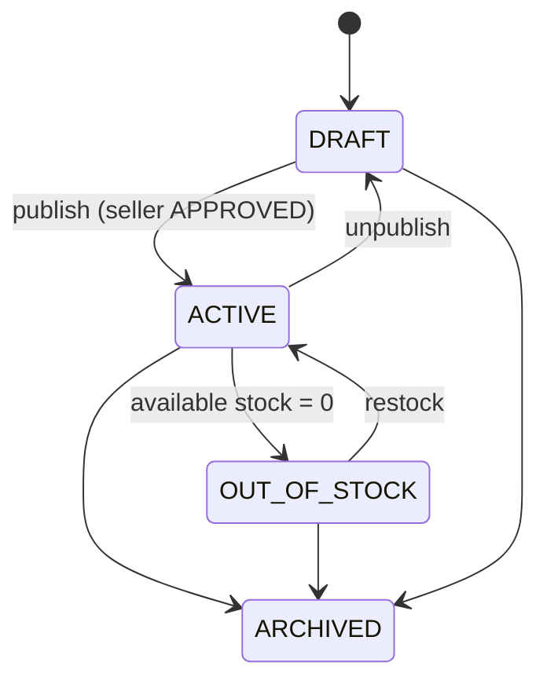
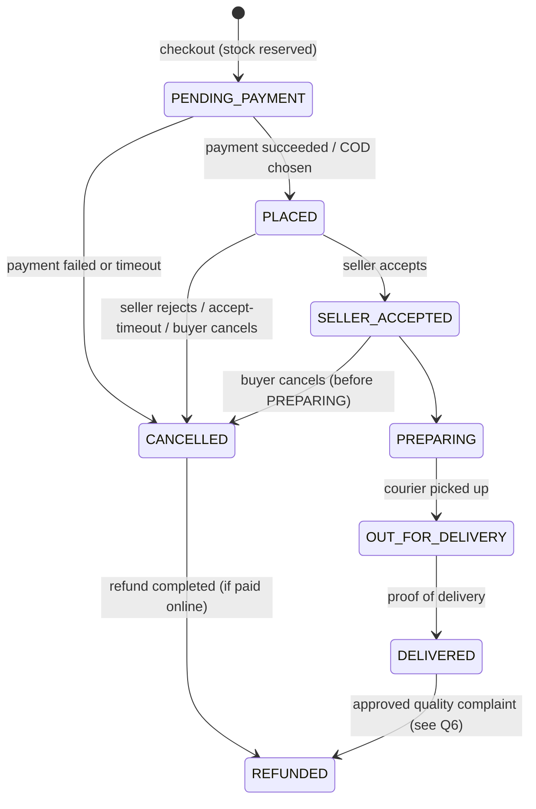

# Nobar — Domain Model

> Status: **Draft for approval** · Last updated: 2026-10-22
> Items marked **(proposal)** are design suggestions, not confirmed business rules. Business rules that still need an owner decision are collected in [§6 Open questions](#6-open-business-questions).

## 1. Bounded contexts

| Context | Type | Service(s) | Why this classification |
|---|---|---|---|
| **Catalog & Freshness** | Core | catalog | Accurate, fresh, city-local supply is the product |
| **Ordering** | Core | cart, order | Multi-seller checkout of perishable goods |
| **Shopping Intelligence** | Core (differentiator) | ai-gateway, ai-workers, search | Assistant, smart search, compare, recommendations |
| **Seller Management** | Supporting | seller | Onboarding, verification, reliability |
| **Payments & Settlement** | Supporting (critical) | payment | Iranian gateways, COD, commission, payouts |
| **Fulfilment** | Supporting | delivery | Zones, slots, couriers |
| **Trust & Reviews** | Supporting | review | Verified reviews, quality reports, moderation |
| **Back-office** | Supporting | admin | Cities, disputes, platform settings |
| **Identity & Access** | Generic | identity | OTP + JWT; could be bought, but needs Iranian SMS |
| **Notification** | Generic | notification | Templated multi-channel messaging |
| **Analytics** | Generic | analytics | Event collection and reporting |

### Context map

OHS = Open Host Service · ACL = Anti-Corruption Layer (the AI layer translates domain data into tool results and never leaks model output back into domain data without validation).

## 2. Core entities and invariants

### Identity & Access
- **User** `(id, phone, role[], city_id, status, created_at)` — phone is the unique login (E.164 `+98…`). One person can hold several roles (a seller can also buy).
- **OtpChallenge** `(phone, code_hash, expires_at, attempts)` — 6 digits, 2-minute expiry, max 5 attempts; raw code never stored.
- **RefreshToken** `(id, user_id, token_hash, family_id, expires_at, revoked_at)` — rotated on every use; reuse of a rotated token revokes the whole family.
- **Address** `(id, user_id, city_id, geo point, text, label)`.

### Seller Management
- **Seller** `(id, user_id, shop_name, city_id, status, description, rating, license_info)` — one seller profile per user **(proposal)**.
- **SellerDocument** `(id, seller_id, type, object_key, uploaded_at)` — stored in MinIO, uploaded via presigned URL.
- Invariant: only `APPROVED` sellers can publish products.

### Catalog & Freshness
- **Category** `(id, parent_id, name, slug)` — a tree (e.g. میوه ← هسته‌دار ← هلو).
- **Product** `(id, seller_id, city_id, category_id, name, description, unit, price_rial, stock, min_order, harvest_date, is_organic, season_tags[], status, version)`
  - `unit ∈ {KG, PIECE, BUNDLE, BOX}`; `price_rial` is a positive integer per unit.
  - `freshness_hours = now − harvest_date` (computed, never stored).
  - `stock` is counted in the product's unit; it may be fractional for `KG` **(open question Q4)**.
  - `version` enables optimistic locking for concurrent stock changes.
- **StockReservation** `(id, product_id, order_id, qty, status, expires_at)` — `HELD → COMMITTED | RELEASED | EXPIRED`. Available stock = stock − Σ HELD.

### Ordering
- **Cart** `(user_id, items[{product_id, seller_id, qty}])` — grouped by seller in responses; price and stock are re-validated on every read. Guest cart merges into the user cart on login.
- **Checkout** `(id, buyer_id, address_id, payment_method, total_rial, idempotency_key, status)` **(proposal)** — one buyer action, one payment, N orders. See Q1.
- **Order** `(id, checkout_id, buyer_id, seller_id, city_id, status, items_total, delivery_fee, commission, total, slot)` — exactly one seller per order.
- **OrderItem** `(id, order_id, product_id, name_snapshot, unit, qty, unit_price_rial)` — price and name are **snapshots** at checkout time.

> `PENDING_PAYMENT` is **(proposal)**: the brief lists PLACED…REFUNDED; an explicit pre-payment state keeps unpaid orders out of seller queues.

### Payments & Settlement
- **Payment** `(id, checkout_id, method, amount_rial, status, gateway, gateway_ref, idempotency_key)` — `method ∈ {GATEWAY, COD, WALLET}`; `status: INITIATED → SUCCEEDED | FAILED | EXPIRED`; refunds are separate records.
- **Refund** `(id, payment_id, order_id, amount_rial, status, reason)` — partial refunds per order are allowed.
- **LedgerEntry** — double-entry: every money movement is a balanced set of entries (Σ debit = Σ credit) over accounts such as `buyer_payments`, `seller_payable:{seller}`, `platform_commission`, `refunds`.
- **CommissionRule** `(scope: category|seller|default, percent_bp, valid_from)` — percent in basis points (integer).
- **Settlement** `(id, seller_id, period, amount_rial, status)`.
- Invariants: no card data is ever stored; amounts are integer Rial; the ledger is append-only.

### Fulfilment
- **DeliveryZone** `(id, seller_id, city_id, polygon)` — PostGIS.
- **TimeSlot** `(id, seller_id, date, start, end, capacity)`.
- **Delivery** `(id, order_id, courier_id, slot_id, fee_rial, status, proof)` — `PENDING → ASSIGNED → PICKED_UP → DELIVERED | FAILED`.

### Trust & Reviews
- **Review** `(id, order_id, product_id, seller_id, buyer_id, rating 1–5, text, tags[], status, seller_reply)` — only for `DELIVERED` orders, one review per order item **(proposal)**.
- **QualityReport** `(id, order_id, photos[], type, status)` — feeds disputes/refunds.

### Back-office
- **City** `(id, name, province, geo, is_active)` — reference data; Nobar operates only in active cities.
- **Dispute** `(id, order_id, type, severity, status, resolution)`.

### Shopping Intelligence
- **ProductEmbedding** `(product_id, model, vector, updated_at)`.
- **AiConversation** `(id, user_id, summary, transcript_ref, created_at, expires_at)`.
- **AiAuditLog** `(id, user_id, conversation_id, tool, input, output_digest, latency_ms, created_at)`.
- **BasketProposal** (value object) — structured list of products, quantities and total produced by the assistant; becomes a cart change only after the user confirms.

## 3. Key domain decisions (proposals to confirm)

1. **Checkout vs Order** — the buyer pays once per checkout; the checkout is split into one order per seller because each seller accepts, prepares, and delivers independently. Refunds are per order.
2. **Snapshot pricing** — order items keep the price and name at checkout time; later product edits do not change existing orders.
3. **Reservation TTL** — stock is held while the buyer is at the payment gateway and released automatically on expiry.
4. **City scoping** — a buyer can only buy from sellers whose delivery zone covers the buyer's address.

## 4. Domain events (catalog, v1)

| Event | Producer | Key data |
|---|---|---|
| `user.registered`, `user.updated` | identity | user_id, roles, city_id |
| `seller.registered/approved/rejected/suspended` | seller | seller_id, city_id, reason? |
| `product.created/updated/archived` | catalog | product snapshot (no stock math) |
| `stock.changed`, `stock.low` | catalog | product_id, available, threshold |
| `cart.updated` | cart | user_id, item count (analytics) |
| `order.placed/accepted/rejected/cancelled/delivered` | order | order_id, checkout_id, seller_id, buyer_id, totals |
| `payment.succeeded/failed/refunded` | payment | payment_id, checkout_id, amount_rial |
| `settlement.paid` | payment | seller_id, period, amount_rial |
| `delivery.assigned/picked_up/completed/failed` | delivery | delivery_id, order_id, courier_id |
| `review.created`, `review.aggregated` | review | product_id, seller_id, rating stats |
| `city.activated/deactivated` | admin | city_id |

Schemas are the source of truth in `packages/contracts` (Phase 0).

## 5. Glossary — واژه‌نامه

| English (code) | فارسی (UI) | Meaning |
|---|---|---|
| Nobar | نوبر | First produce of the season; the brand |
| Buyer | خریدار | End customer |
| Seller / Shop | فروشنده / غرفه | Farmer, orchard owner or stall owner with a shop on Nobar |
| Courier | پیک | Delivers orders |
| Admin | ادمین (مدیر سامانه) | Platform operator |
| City / Province | شهر / استان | Operating unit of the marketplace |
| Category | دسته‌بندی | Product category tree |
| Product | محصول | A seller's listing |
| Unit: kg / piece / bundle / box | کیلوگرم / عدد / دسته / جعبه | Selling unit |
| Harvest date | تاریخ برداشت | When the produce was picked |
| Freshness | تازگی | Hours since harvest |
| Organic | ارگانیک | Organic flag |
| Seasonal | فصلی | In-season produce |
| Stock | موجودی | Available quantity |
| Reservation | رزرو موجودی | Temporary hold during checkout |
| Minimum order | حداقل سفارش | Smallest quantity per order |
| Cart | سبد خرید | Items before checkout |
| Checkout | تکمیل خرید | Paying for a cart; produces orders |
| Order | سفارش | One seller's part of a checkout |
| Payment gateway | درگاه پرداخت | ZarinPal, Shaparak, … |
| Cash on delivery (COD) | پرداخت در محل | Pay the courier |
| Wallet | کیف پول | Stored balance |
| Commission | کارمزد / کمیسیون | Platform's share |
| Settlement / Payout | تسویه‌حساب / واریز | Paying sellers |
| Refund | بازپرداخت (استرداد وجه) | Returning money |
| Ledger | دفتر کل | Double-entry money records |
| Delivery zone | محدوده‌ی ارسال | Area a seller delivers to |
| Time slot | بازه‌ی زمانی تحویل | Delivery window |
| Proof of delivery | تأییدیه‌ی تحویل | Code/photo/signature at hand-off |
| Review / Rating | نظر / امتیاز | Buyer feedback |
| Quality report | گزارش کیفیت | Complaint with photo |
| Dispute | اختلاف / شکایت | Case handled by admin |
| OTP | کد یکبارمصرف | SMS login code |
| Rial / Toman | ریال / تومان | 1 Toman = 10 Rial; stored in Rial, shown in Toman |
| Jalali calendar | تقویم شمسی | Display calendar |
| Shopping assistant | دستیار خرید | AI chat assistant |
| Smart compare | مقایسه‌ی هوشمند | AI-assisted comparison |
| Recommendation | پیشنهاد | Personalized suggestions |
| Seller copilot | دستیار فروشنده | AI tools for sellers |
| Basket proposal | پیشنهاد سبد | Assistant's suggested basket, needs confirmation |
| "AI suggestion" label | پیشنهاد هوشمند | Marks AI-generated content |

## 6. Open business questions

These affect code but are business decisions — they will **not** be guessed. Defaults in brackets are only placeholders until answered.

| # | Question | Needed by |
|---|---|---|
| Q1 | One payment for a multi-seller checkout (split into per-seller orders), or a separate payment per seller? [one payment] | Phase 1 (order, payment) |
| Q2 | Who pays delivery, and how is the fee set: per seller order, flat per city, by distance/zone? [per seller order, seller-defined] | Phase 1–2 |
| Q3 | Commission: default percentage, and does it vary by category/seller? Is it taken from item total only or also delivery fee? [configurable, items only] | Phase 1 (payment) |
| Q4 | Can buyers order fractional kilograms (e.g. 1.5 kg)? Step size? Weight variance tolerance at packing (actual weight differs)? | Phase 1 (catalog, cart) |
| Q5 | Seller accept-timeout: how long before an unaccepted order auto-cancels? [30 min during working hours] | Phase 1 (order saga) |
| Q6 | Refund/return policy for perishables: full/partial refund on quality complaint, within how many hours, photo required? | Phase 2 (review, payment) |
| Q7 | Cash on delivery limits (max amount, new-user restriction)? | Phase 1 (payment) |
| Q8 | Settlement cycle for sellers (daily/weekly), hold period after delivery? | Phase 1–2 (payment) |
| Q9 | Seller verification: which documents are required (national ID, business license, agricultural permit)? | Phase 1 (seller) |
| Q10 | Launch cities (pilot city or several)? | Phase 1 (seed data) |
| Q11 | Wallet: in scope for MVP? Top-up allowed or only refunds into wallet? | Phase 1 (payment) |
| Q12 | Can one user be both seller and buyer with one phone number? [yes] | Phase 1 (identity) |
